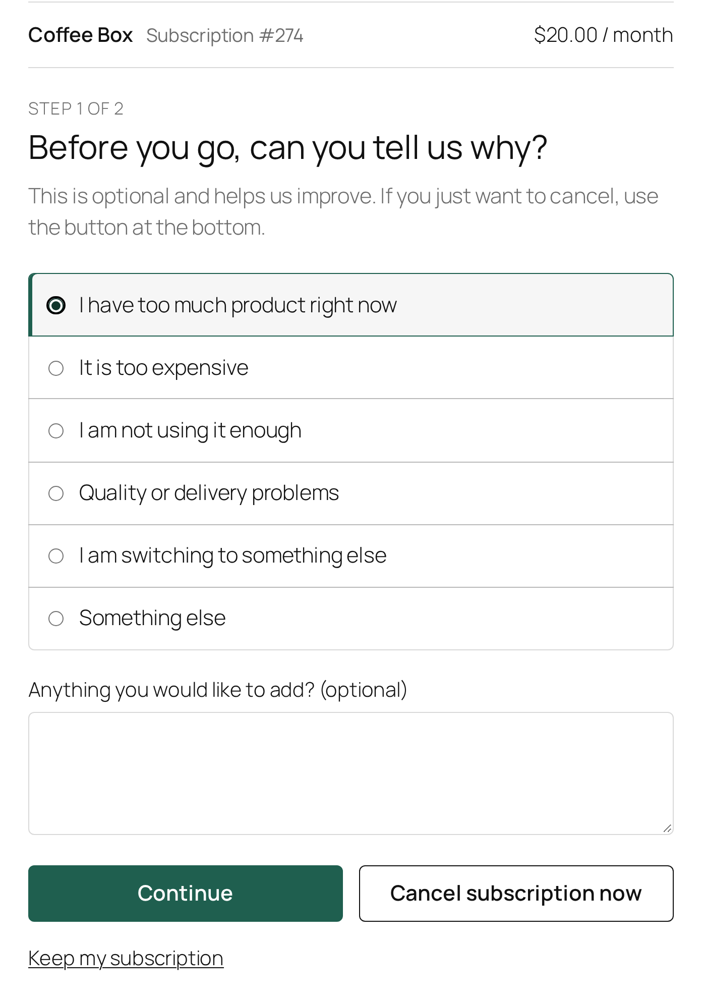
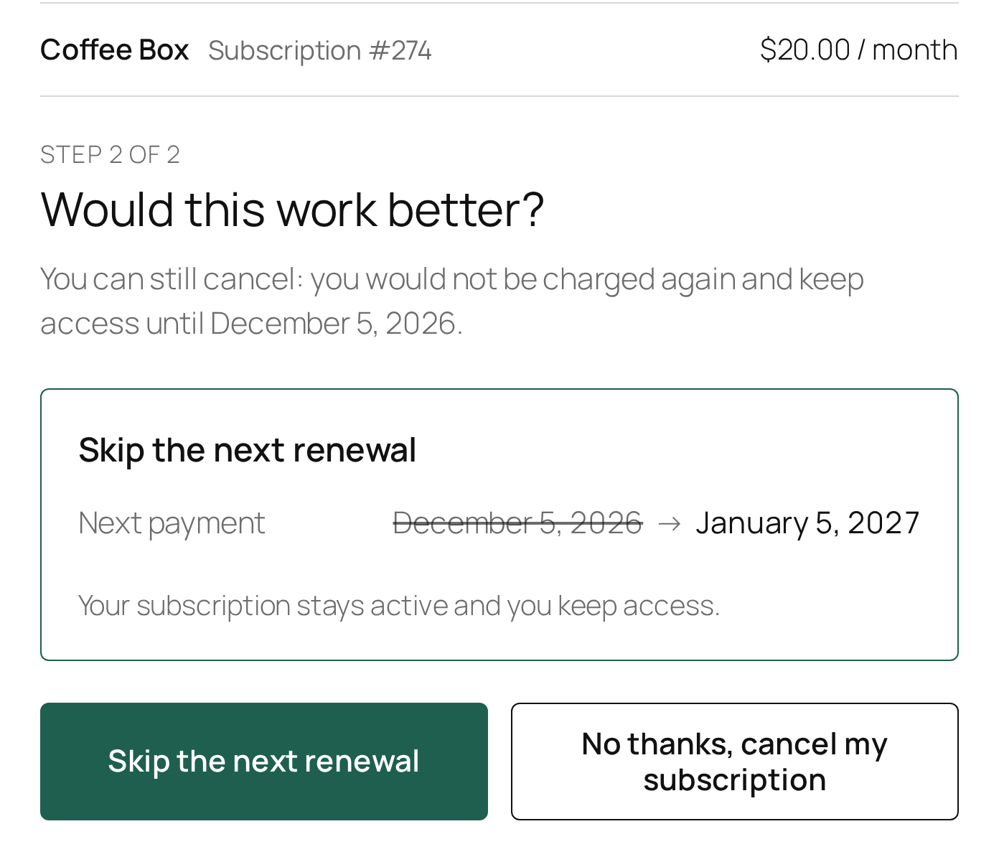

# ChurnAnchor: a fair cancellation flow for WooCommerce Subscriptions

ChurnAnchor is a free WordPress plugin (GPL-2.0-or-later) for stores that use WooCommerce Subscriptions. When a customer clicks **Cancel**, it asks why (optional), offers one alternative that fits the reason (skip the next renewal, or pause for 1–3 months), and keeps a **cancel button on every step**. A dashboard shows how much monthly revenue you actually kept: a save counts only after the customer's next renewal is paid.

- Website and docs: https://churnanchor.marul.co
- 45-second video: https://churnanchor.marul.co/video/churnanchor-demo.webm
- Download the latest release: see [Releases](../../releases), or https://churnanchor.marul.co/downloads/churnanchor-0.2.2.zip
- WordPress.org: submitted, awaiting review

## Why another cancellation plugin?

| | ChurnAnchor |
|---|---|
| Asks why, then matches the offer to the reason | Yes |
| Cancel button on every step, reason optional | Yes |
| Stops "skip, then cancel" free time (access ends at the paid-through date) | Yes |
| Counts a save only after a paid renewal | Yes |
| External requests | None |
| Price | Free; optional Pro add-on from $99/yr |

A comparison with Subscription Churn Saver, Cancellation Survey and Offers, StaySub, RetainFlow and Churn Solution: https://churnanchor.marul.co/compare/woocommerce-subscriptions-retention-plugins/

## Requirements

WordPress 6.5+, WooCommerce 9.0+, WooCommerce Subscriptions, PHP 7.4+. HPOS compatible.

## Install

1. Download the zip from Releases (or the website).
2. WordPress admin → Plugins → Add New → Upload Plugin.
3. Activate. Settings: WooCommerce → ChurnAnchor.

## How it works

1. **Reason (optional):** "Too much product", "Too expensive", "Not using it enough", "Quality or delivery problems", "Switching", "Something else". Editable.
2. **Offer:** each reason maps to skip, pause or no offer. Skip moves the next payment one billing period; pause moves it 1–3 months. The subscription stays active, no "resume" step.
3. **Cancel any time:** "Cancel subscription now" on the first screen and "No thanks, cancel" next to the offer.
4. **Honest numbers:** accepted offers are *pending* until the next renewal is paid (*verified*), or *lost* if the customer cancels anyway.
5. **Fair rules:** one offer per subscription per cooldown (90 days by default); if someone skips or pauses and then cancels, access ends on the date they paid for.

## Developer hooks

| Hook | Type | Use |
|---|---|---|
| `churnanchor_offers_for_reason( $offers, $reason_key, $sub )` | filter | Offers (keys) for a reason, in order |
| `churnanchor_offer_eligible( false, $sub, $offer )` | filter | Eligibility for custom offers |
| `churnanchor_offer_details( $details, $sub, $offer )` | filter | Title, before/after rows and button text for an offer |
| `churnanchor_apply_offer( null, $sub, $offer )` | filter | Apply a custom offer; return true or WP_Error |
| `churnanchor_max_offers( 3 )` | filter | How many eligible offers to show (1–3) |
| `churnanchor_offer_accepted( $sub, $offer, $flow_id )` | action | After an offer is applied |
| `churnanchor_subscription_cancelled( $sub, $reason, $flow_id )` | action | After a cancellation through the flow |
| `churnanchor_event( $id, $row )` | action | Every recorded flow event |

Template override: copy `templates/cancel-flow.php` to `yourtheme/churnanchor/cancel-flow.php`.

## ChurnAnchor Pro

An optional paid add-on adds a one-time renewal discount, a 4–6 month pause, "ask the store to fix it", up to two offers per reason, category rules, win-back and renewal reminder emails, auto-renewal consent records at checkout (classic and block), and per-offer reports. https://churnanchor.marul.co/pricing/

## Support

support@churnanchor.marul.co · Issues and pull requests welcome.

## License

GPL-2.0-or-later
